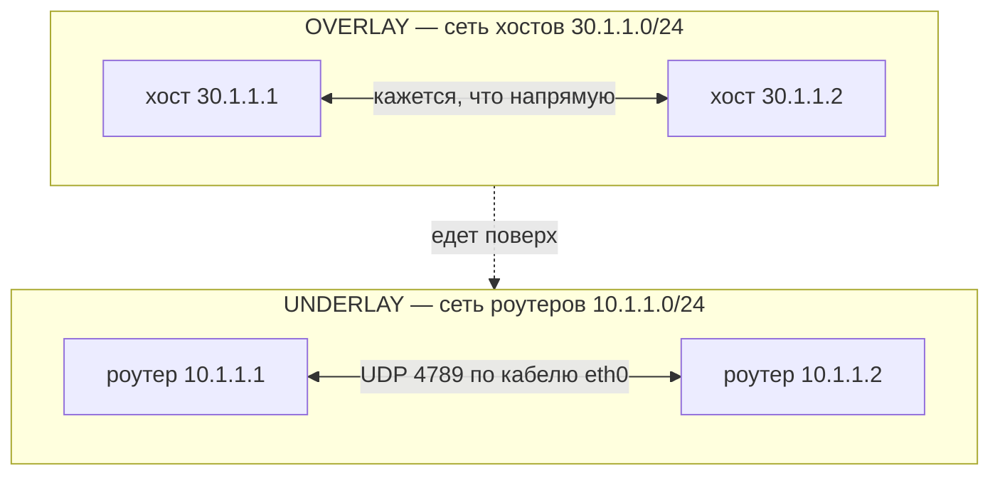
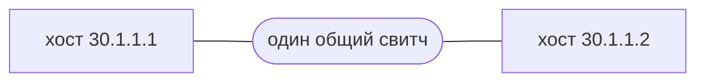
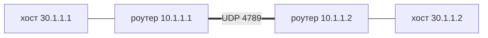
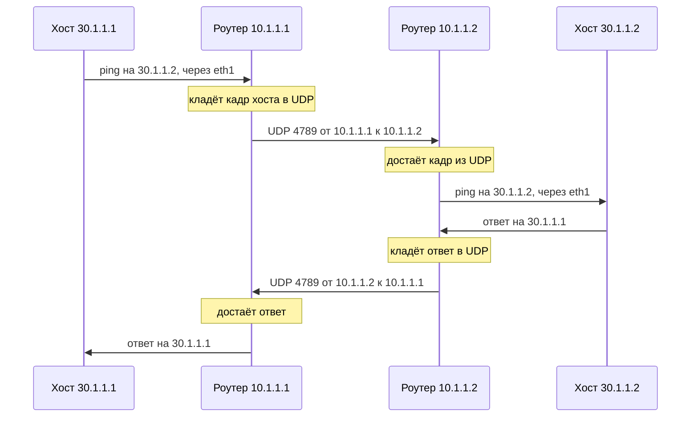
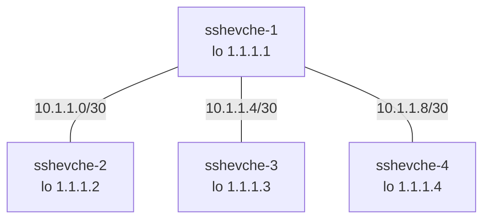
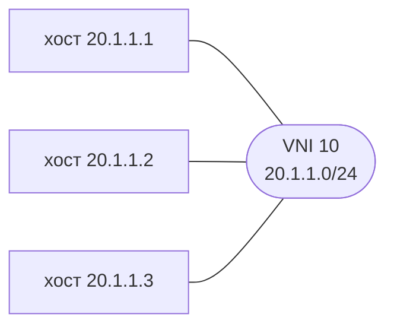
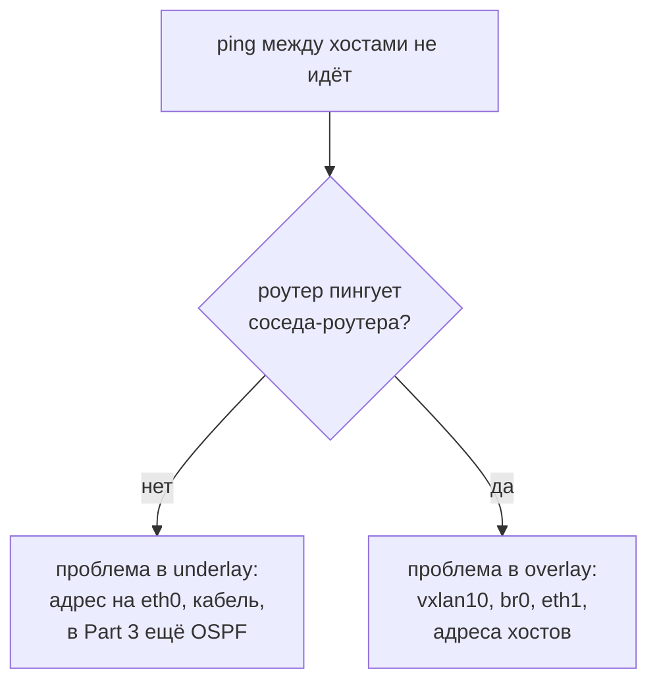

# Overlay и underlay

Одна сеть, два этажа.

- **Underlay** — настоящая сеть роутеров. По ней физически едут пакеты.
- **Overlay** — виртуальная сеть хостов. Она построена поверх underlay через туннель VXLAN.



---

## Как видят хосты и как на самом деле

Хост думает, что сосед стоит рядом, на одном свитче:



На самом деле между ними два роутера и кабель:



«Общий свитч» с первой картинки — это два роутера со второй. Хосты о них не знают.

---

## Главное: две пары адресов в одном пакете

Хост `30.1.1.1` пингует `30.1.1.2`. По кабелю между роутерами идёт такой пакет:

```text
┌──────────────────────────────────────────────────────┐
│ UNDERLAY — это читают роутеры                        │
│ от 10.1.1.1   кому 10.1.1.2   UDP 4789   VNI 10      │
│                                                      │
│   ┌──────────────────────────────────────────────┐   │
│   │ OVERLAY — это читают хосты                   │   │
│   │ от 30.1.1.1   кому 30.1.1.2   ping           │   │
│   └──────────────────────────────────────────────┘   │
└──────────────────────────────────────────────────────┘
```

Внешняя пара адресов — underlay. Внутренняя — overlay. Пакет один, этажей два.

### Письмо в конверте

```text
        ┌───────────────────────────────┐
        │ КОНВЕРТ                       │
        │ на отделение 10.1.1.2         │   ← читает почта (underlay)
        │                               │
        │    ┌─────────────────────┐    │
        │    │ ПИСЬМО              │    │
        │    │ лично 30.1.1.2      │    │   ← читает человек (overlay)
        │    └─────────────────────┘    │
        └───────────────────────────────┘
```

Почта смотрит только на конверт и везёт его до отделения. Что внутри, ей всё равно.

Получатель открывает конверт и читает письмо. Какими отделениями оно ехало, ему всё равно.

---

## Кто что знает

| | Хост | Роутер |
|--|------|--------|
| Свой адрес | `30.1.1.x` | `10.1.1.x` |
| Знает адрес соседа-хоста | да | нет, просто передаёт кадр |
| Знает адрес соседа-роутера | нет | да, `remote` в конфиге |
| Знает про UDP 4789 | нет | да |
| Этаж | overlay | underlay, и вход в туннель |

---

## Путь ping по шагам



Хосты обмениваются только адресами `30`. Роутеры между собой — только адресами `10`. Встречаются этажи на роутере: там кадр заворачивают и разворачивают.

---

## Где этажи внутри роутера

```text
                    роутер 10.1.1.1
          ┌──────────────────────────────────┐
          │  OVERLAY        │   UNDERLAY     │
          │                 │                │
хост ─────┼─ eth1 ── br0 ── vxlan10 ── eth0 ─┼───── роутер 10.1.1.2
          │                 │                │
          └──────────────────────────────────┘
```

- `eth1` и `br0` — сторона хоста, overlay.
- `eth0` с адресом `10.1.1.1` — сторона роутеров, underlay.
- `vxlan10` — дверь между этажами. В неё входит кадр хоста, из неё выходит UDP.

---

## Этажи в конфиге роутера Part 2

Файл `P2/_dmiasnik-1_s` делится на две части.

Underlay — адрес роутера на кабеле к соседу:

```bash
ip addr add 10.1.1.1/24 dev eth0
ip link set eth0 up
```

Туннель — дверь между этажами, адрес соседа-роутера:

```bash
ip link add vxlan10 type vxlan id 10 remote 10.1.1.2 dstport 4789 dev eth0
ip link set vxlan10 up
```

Overlay — мост, который соединяет хоста с туннелем:

```bash
brctl addbr br0
brctl addif br0 vxlan10
brctl addif br0 eth1
ip link set br0 up
ip link set eth1 up
```

Адресов хостов `30.1.1.x` в конфиге роутера нет вообще. Они живут только в файлах хостов, например `P2/_dmiasnik-1_host`:

```bash
ip addr add 30.1.1.1/24 dev eth0
ip link set eth0 up
```

---

## Увидеть оба этажа своими глазами

Пока хост пингует соседа, запусти `tcpdump` в двух местах.

```text
   хост 30.1.1.1                роутер 10.1.1.1
  ┌───────────────┐            ┌──────────────────┐
  │ tcpdump здесь │            │ tcpdump на eth0  │
  │ видит только  │            │ видит оба этажа  │
  │ адреса 30     │            │ 10 снаружи,      │
  │               │            │ 30 внутри        │
  └───────────────┘            └──────────────────┘
```

На хосте — только overlay:

```text
IP 30.1.1.1 > 30.1.1.2: ICMP echo request
```

На `eth0` роутера (`tcpdump -i eth0 -n port 4789`) — underlay снаружи и тот же ping внутри:

```text
IP 10.1.1.1.xxxxx > 10.1.1.2.4789: VXLAN, vni 10
    IP 30.1.1.1 > 30.1.1.2: ICMP echo request
```

Точный формат строк зависит от версии `tcpdump`. Смысл один: та же передача видна на двух уровнях.

---

## Part 3: те же этажи, больше роутеров

Underlay — четыре роутера, линки `/30` и loopback. Маршруты между ними строит OSPF:



Overlay — три хоста, которым кажется, что они на одном свитче VNI 10:



Хост `20.1.1.1` (за `sshevche-2`) пингует `20.1.1.3` (за `sshevche-4`). Внешние адреса пакета — loopback роутеров `1.1.1.2` и `1.1.1.4`. Верхний роутер `sshevche-1` стоит на пути в underlay и просто пересылает этот UDP. Про хостов `20.1.1.x` он не знает.

```text
хост 20.1.1.1 → sshevche-2 ══ sshevche-1 ══ sshevche-4 → хост 20.1.1.3
                    1.1.1.2     пересылает    1.1.1.4
                    заворачивает              разворачивает
```

---

## Если хосты не пингуются

Всегда снизу вверх: overlay едет по underlay, поэтому без нижнего этажа верхний не работает.



- Part 2: с роутера `ping 10.1.1.2`.
- Part 3: с роутера `ping 1.1.1.2`, `1.1.1.3`, `1.1.1.4`.

---

## Коротко

Underlay — сеть роутеров, адреса `10.1.1.x` (и `1.1.1.x` в Part 3). Overlay — сеть хостов, адреса `30.1.1.x` в Part 2 и `20.1.1.x` в Part 3. В одном пакете на кабеле обе пары: внешняя для роутеров, внутренняя для хостов. Роутер заворачивает кадр хоста в UDP и разворачивает его на другом конце.
